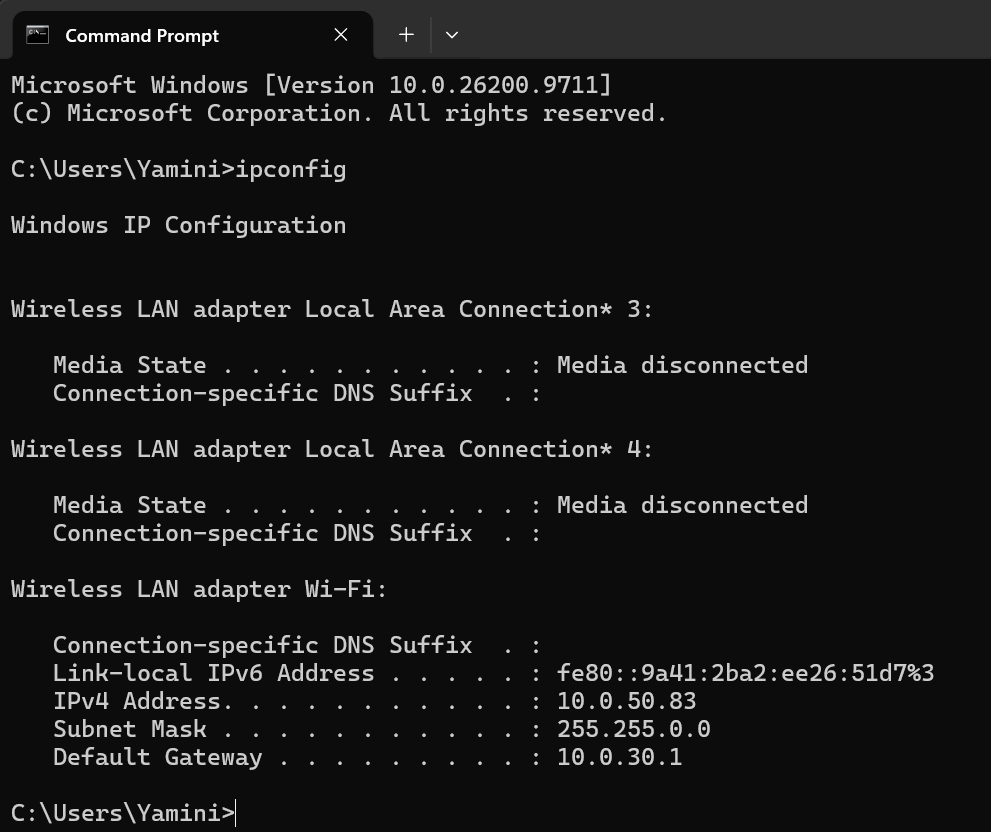
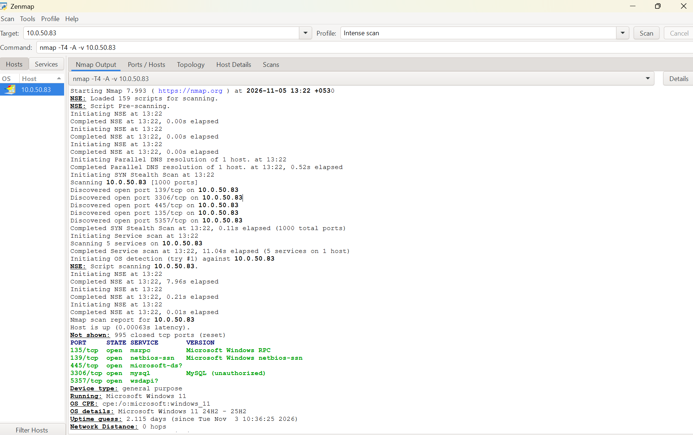
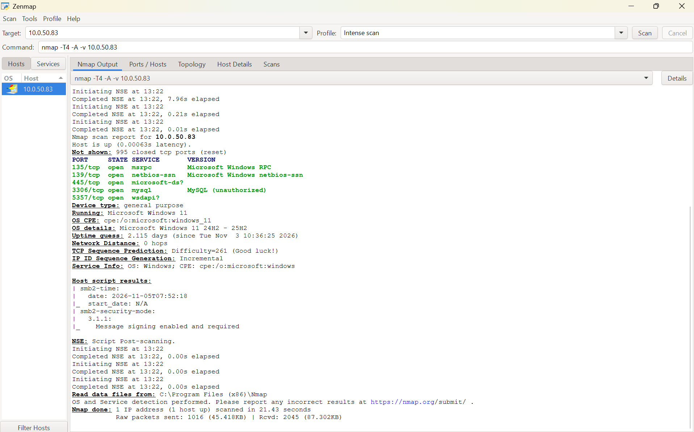

# Task 1: Scan Your Local Network for Open Ports

**Name:** Yamini Sivakumar  
**Date:** 05 November 2026  
**Tools:** Nmap 7.993 (Zenmap GUI), Windows Command Prompt, Wireshark (optional)

## Objective
Discover open ports on a device in my local network, identify the services running on them, and understand the security risks of network exposure.

## Scope
My Wi-Fi uses subnet mask `255.255.0.0` (/16), a large shared network. To stay safe and authorized, I scanned **only my own laptop** (`10.0.50.83`) and not other devices.

## Steps
1. Installed Nmap (with Zenmap) from the official website.
2. Ran `ipconfig` to find my IP details: IPv4 `10.0.50.83`, mask `255.255.0.0`, gateway `10.0.30.1`.
3. Ran the scan in Zenmap: `nmap -T4 -A -v 10.0.50.83` (includes the TCP SYN stealth scan, service/version detection, OS detection and default scripts).
4. Noted the open ports and services.
5. Researched the services and identified the risks.
6. Saved the scan output as `scan_results.txt`.

## Results
| Port | State | Service | Details |
|------|-------|---------|---------|
| 135/tcp | open | msrpc | Microsoft Windows RPC |
| 139/tcp | open | netbios-ssn | NetBIOS session service |
| 445/tcp | open | microsoft-ds (SMB) | File/printer sharing, SMB signing required |
| 3306/tcp | open | mysql | MySQL (reported "unauthorized") |
| 5357/tcp | open | wsdapi | Windows device discovery |

Host: Windows 11 (24H2 to 25H2), 995 of 1000 ports closed, scan time 21.43 s.

## Screenshots
**1. ipconfig (network details)**

**2. Zenmap scan output (start of scan)**

**3. Zenmap scan output (open ports, OS and SMB details)**

## Security Risks
- **135 / 139 / 445:** Windows RPC, NetBIOS and SMB are common attack targets (for example, WannaCry used SMB on unpatched systems).
- **3306:** A database server should not be reachable from the network (password guessing, data theft).
- **5357:** Low risk, but reveals the device on the network.

## Mitigation
- Keep Windows updated and the firewall on.
- Set the Wi-Fi profile to Public and turn off file sharing and network discovery if not needed.
- Bind MySQL to localhost (`bind-address = 127.0.0.1`), use a strong password, or stop it when not in use.
- Keep SMB signing enabled and disable SMBv1.

## Files
- `README.md` : this summary
- `scan_results.txt` : full Nmap output
- `Nmap_Open_Port_Discovery_Report.pdf` : detailed report
- `interview_questions.md` : answers to the interview questions
- `1_ipconfig.png`, `2_nmap_output_top.png`, `3_nmap_output_bottom.png` : screenshots

## Key Concepts
Port scanning, TCP SYN scan, IP ranges, network reconnaissance, open ports, network security basics.
